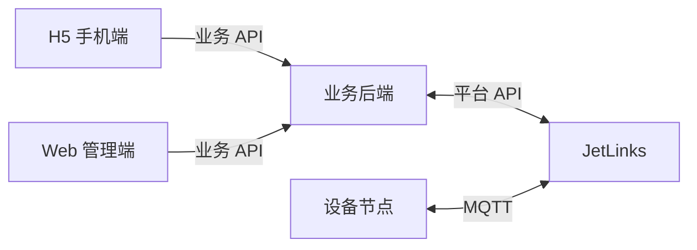

# 前端技术框架

本文记录 `frontend/` 的初始化参考，覆盖 H5 手机端与 Web 管理端。当前仓库尚未初始化前端工程；具体页面、接口和设备流程由实际项目定义。

## 建议技术选型

| 类别 | 选型 | 用途 |
| --- | --- | --- |
| 前端框架 | Vue 3 | 使用组合式 API 与单文件组件构建页面 |
| 构建工具 | Vite | 本地开发、模块处理和生产构建 |
| 开发语言 | TypeScript | 定义组件、接口和业务状态的类型 |
| 后台骨架 | Soybean Admin | Web 端布局与主题的参考 |
| UI 组件库 | Nuxt UI | 基础交互组件的参考选型 |
| 样式方案 | Tailwind CSS | 布局、响应式适配与主题定制 |
| 路由管理 | Vue Router | 页面导航与路由参数 |
| 状态管理 | Pinia | 跨页面共享状态 |
| 接口请求 | Axios | 统一请求与错误处理 |
| 包管理 | pnpm | 安装依赖、执行脚本和维护锁文件 |

建议采用 Vite + Vue 3 的单页应用。Soybean Admin、Nuxt UI 与 Tailwind CSS 的实际组合应在工程初始化时验证兼容性；具体版本以 `package.json` 和 `pnpm-lock.yaml` 为准。

## 两端职责

| 目录 | 场景 | 主要职责 |
| --- | --- | --- |
| `frontend/h5/` | 手机浏览器 | 小屏布局、触控交互与简洁的业务流程 |
| `frontend/web/` | 电脑浏览器 | 表格、筛选、详情及管理操作 |

两端可共享基础技术栈，但应按实际需求决定是否同时创建。若 H5 通过 NFC 标签中的链接打开，页面无需浏览器 NFC 读写能力。涉及状态变更的结果以业务后端确认结果为准。

## 系统对接

浏览器调用自建业务后端，由后端封装数据库、外部平台和权限校验。若项目使用 JetLinks，可采用以下关系：

前端负责展示、表单交互和操作反馈；业务后端负责业务规则、身份权限及外部平台凭据。设备联动不应依赖前端页面持续打开。

## 开发约定

- Vue 组件使用单文件组件，逻辑部分采用 `<script setup lang="ts">`。
- 页面负责展示与交互；接口请求集中封装，避免重复的地址和错误处理。
- Axios 统一处理基础地址、超时、已约定的鉴权信息与通用错误；页面补充操作反馈。
- Pinia 用于跨页面状态；局部状态使用 Vue 的响应式能力。
- 接口数据定义 TypeScript 类型。前端校验提供交互提示，业务规则和权限由后端复核。
- 展示加载、空数据和失败状态；后端确认前不展示操作成功。
- 使用 pnpm 管理依赖并提交 `pnpm-lock.yaml`。
- `.env` 或 `.env.*` 中的前端变量只放可公开配置；真实凭据不得进入前端包。
- 文本文件使用 UTF-8 与 LF 换行，其他格式遵循项目实际 `.editorconfig`。

## 项目落地时补充

- Node.js 与依赖版本、安装及构建命令。
- 登录方式、角色和操作权限。
- API 路径、数据结构及错误码。
- 页面清单、状态更新方式与部署地址。
- 开发代理及生产环境 API 配置。

参考：[Vue 3](https://cn.vuejs.org/)、[Vite](https://cn.vite.dev/)、[Soybean Admin](https://github.com/soybeanjs/soybean-admin)、[Nuxt UI](https://ui.nuxt.com/)、[Tailwind CSS](https://tailwindcss.com/)。
